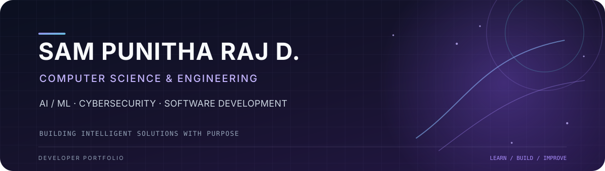

<!-- GitHub Profile README for SamPunithaRajD -->

  
   
  
   
  
  

---

## About

I'm **Sam Punitha Raj D.**, a Computer Science and Engineering student at **St. Joseph's College of Engineering, Chennai**. I enjoy building practical software and exploring how AI, data, and security can solve real-world problems.

- **Interests:** Artificial Intelligence, Machine Learning, Cybersecurity, and Software Engineering.
- **Research:** Exploring speech foundation models and explainable multimodal learning.
- **Approach:** Learn deeply, build thoughtfully, and keep improving.

## Tech Stack

  

## Featured Projects

<table>
  <tr>
    <td width="50%" valign="top">
      <h3><a href="https://github.com/SamPunithaRajD/Foundation-speech-aphasia">FoundationSpeech-Aphasia</a></h3>
      
Research prototype exploring speech foundation models, acoustic and linguistic features, and explainable prediction for aphasia severity assessment.

      
Python · Speech AI · Multimodal Learning · Explainable AI

    </td>
    <td width="50%" valign="top">
      <h3><a href="https://github.com/SamPunithaRajD/VerifiAge">VerifiAge</a></h3>
      
Computer-vision project focused on age prediction from facial images, with an emphasis on reliable data preparation and model evaluation.

      
Python · Computer Vision · Deep Learning

    </td>
  </tr>
  <tr>
    <td width="50%" valign="top">
      <h3><a href="https://github.com/SamPunithaRajD/Ko-nect-Metro">KO-NECT</a></h3>
      
AI-assisted metro operations planning prototype designed to support trainset induction decisions and operational constraints.

      
React · TypeScript · AI · Operations Planning

    </td>
    <td width="50%" valign="top">
      <h3><a href="https://github.com/SamPunithaRajD/17-Bit-Encoder-DAQ-System">17-Bit Encoder DAQ System</a></h3>
      
Industrial automation desktop application for acquiring and processing absolute encoder readings through digital I/O hardware.

      
Python · wxPython · Digital I/O · Data Acquisition

    </td>
  </tr>
</table>

## Experience & Highlights

- **Indian Institute of Astrophysics — Vainu Bappu Observatory:** Worked on an industrial-grade absolute encoder data acquisition system.
- **Hitachi Systems India — Security Operations Center:** Gained practical exposure to security monitoring, endpoint detection, and cybersecurity frameworks.
- **IEEE Zonal Rounds:** Secured **Third Prize**.
- **BMCRI Docathon:** Project finalist with **MedAudit AI**, a medical document auditing concept.

## GitHub at a Glance

  
  

  

## Contribution Journey

  <picture>
    <source media="(prefers-color-scheme: dark)" srcset="https://raw.githubusercontent.com/SamPunithaRajD/SamPunithaRajD/output/github-contribution-grid-snake-dark.svg" />
    <source media="(prefers-color-scheme: light)" srcset="https://raw.githubusercontent.com/SamPunithaRajD/SamPunithaRajD/output/github-contribution-grid-snake.svg" />
    
  </picture>

---

  <h3>Let's connect and build something meaningful.</h3>
  <a href="https://www.linkedin.com/in/sam-punitha-raj-d-5067902b9/">LinkedIn</a>
  &nbsp;·&nbsp;
  <a href="https://github.com/SamPunithaRajD">GitHub</a>
    
  Designed with intention · Built with curiosity

